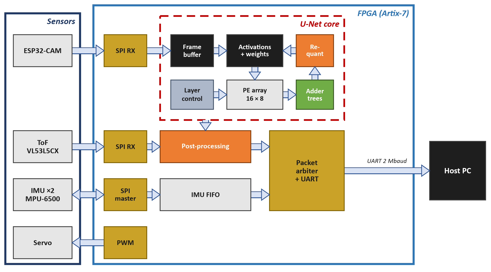
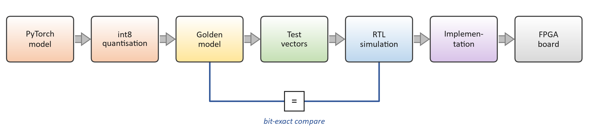
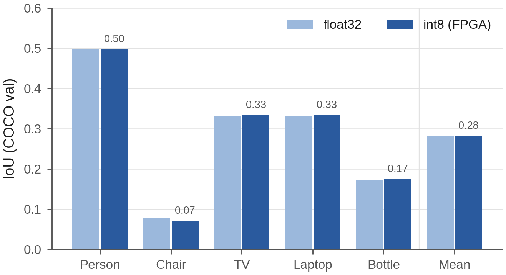
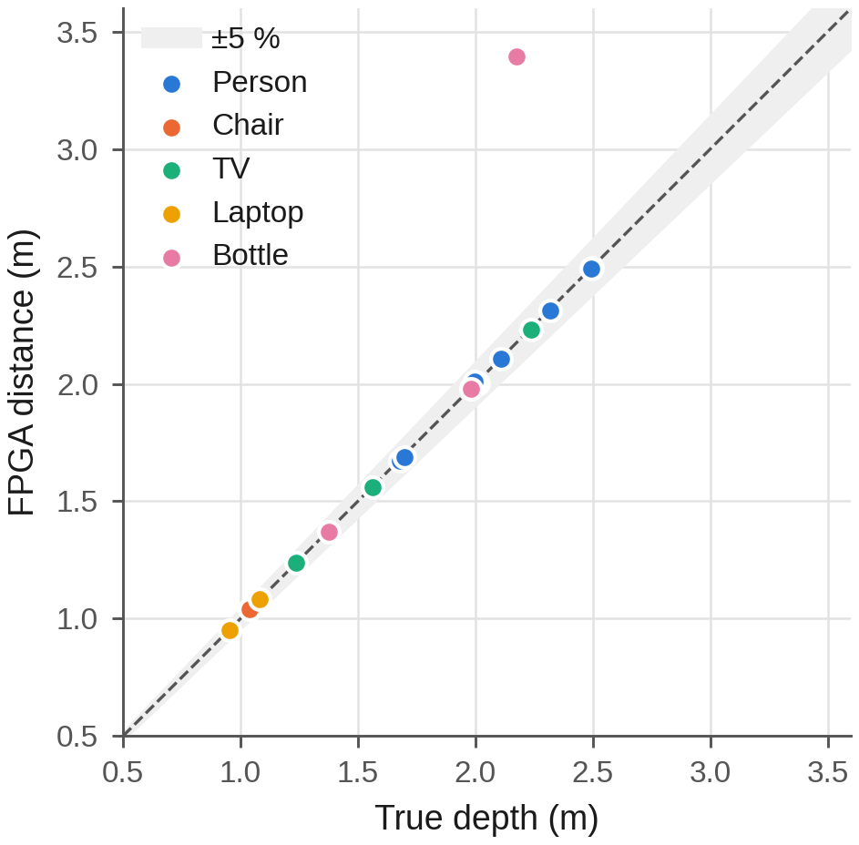
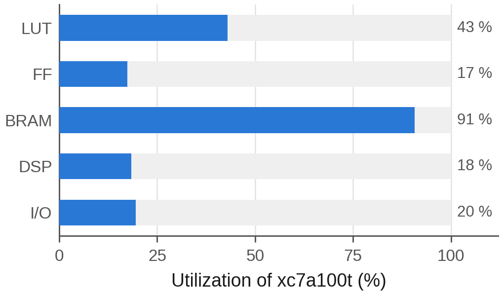
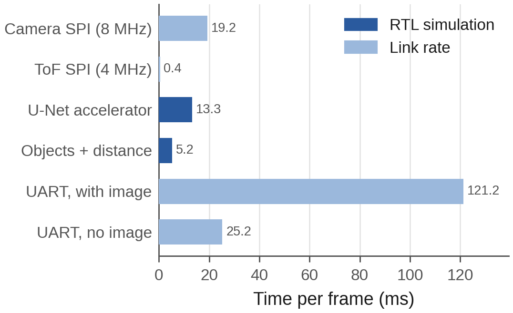

# Multi-Sensor FPGA Perception System

Real-time object segmentation with per-object distance on an FPGA. A camera, an 8×8 time-of-flight (ToF)
sensor and two inertial measurement units (IMUs) are read by a Xilinx Artix-7 FPGA. The FPGA runs an int8
U-Net accelerator and the sensor fusion, drives a servo, and streams the results to a host PC.



## Highlights

| | |
|---|---|
| Platform | Digilent Nexys 4 DDR, Artix-7 XC7A100T-1CSG324C, 100 MHz |
| Network | Tiny U-Net, 12 conv layers, 206 K parameters, 164 M MAC per frame, int8 |
| Accelerator | 16 × 8 PE array (128 int8 MAC per cycle), 20-stage pipeline, 13.3 ms per frame |
| Sensor fusion | 8×8 ToF zones projected onto the 80×60 label map, distance per object on the FPGA |
| Throughput (measured) | 14.5 frames/s results, IMU 100 samples/s, 0 lost packets |
| Resources | 27 232 LUT (43 %), 22 036 FF, 122.5 / 135 BRAM, 44 DSP |
| Timing | met at 100 MHz, WNS +0.128 ns, WHS +0.013 ns |
| Verification | golden model bit-exact against the RTL: 12/12 layers, 0 differing UART bytes |
| Accuracy | int8 and float32 label maps agree on 98.17 % of pixels (1000 COCO val images) |

## Repository structure

| Folder | Contents |
|---|---|
| [`golden_model/`](golden_model) | Python reference model of the whole system; the RTL is verified against it |
| [`model/`](model) | Training, quantisation, trained weights, results and predictions of the U-Net |
| [`dataset/`](dataset) | COCO 2017 validation subset used for evaluation (1000 images, 6 classes) |
| [`rtl/`](rtl) | SystemVerilog design |
| [`tb/`](tb) | SystemVerilog testbenches |
| [`hw/`](hw) | Constraints, build / simulation / programming scripts, memory images, Vivado results and bitstream |
| [`sw/`](sw) | Host PC software: dashboard, viewers, figure generation |
| [`firmware/`](firmware) | Arduino sketches for the camera and ToF sensor nodes |
| [`docs/`](docs) | Architecture, microarchitecture and datapath figures; scripts that draw all figures and graphs |

## Design flow



1. The U-Net is trained in PyTorch with quantisation-aware training and exported as int8 (`model/`).
2. The golden model reproduces every hardware stage in integer arithmetic and generates the test vectors (`golden_model/`).
3. The RTL is simulated in Vivado xsim against those vectors (`rtl/`, `tb/`).
4. The design is implemented with timing met, and the bitstream is tested on the board (`hw/`).

## Quick start

All commands run from the repository root (Windows PowerShell, Vivado 2024.1, Python 3.10+).

```powershell
# golden model: bit-exact checks against the stored golden vectors and RTL simulation output
pip install -r golden_model/requirements.txt
python golden_model/verification/verify_int8_vs_golden_vectors.py
python golden_model/verification/verify_rtl_simulation_output.py

# RTL simulation (all testbenches)
powershell -ExecutionPolicy Bypass -File hw\scripts\run_sim.ps1 -Test all

# synthesis, implementation and bitstream
powershell -ExecutionPolicy Bypass -File hw\scripts\build.ps1

# program the board and run the dashboard
C:\Xilinx\Vivado\2024.1\bin\vivado.bat -nojournal -nolog -mode batch -source hw\scripts\program_board.tcl
python sw/fpga_dashboard.py --port COM3
```

## Hardware setup

| Device | Nexys 4 DDR | Link |
|---|---|---|
| ESP32-CAM | Pmod JA (CS JA1, MOSI JA2, SCLK JA4, GND JA5) | SPI 8 MHz |
| ESP32 + VL53L5CX | Pmod JB (CS JB1, MOSI JB2, SCLK JB4, GND JB5) | SPI 4 MHz |
| 2 × MPU-6500 | Pmod JC (CS1 JC1, MISO JC2, MOSI JC3, SCLK JC4, CS2 JC7, 3V3 JC6, GND JC5) | SPI 0.5 MHz |
| Servo | Pmod JD1 signal, external 5 V supply, common GND on JD5 | PWM 50 Hz |
| Host PC | USB-UART | 2 Mbaud |

Board switches: SW0 sends the camera image with each result, SW1 selects the servo sweep, SW15–SW8 set the
servo angle in manual mode.

## Results

| Measurement | Value | Source |
|---|---|---|
| U-Net inference | 1 327 877 cycles = 13.3 ms | RTL simulation, confirmed on board |
| Post-processing | 1–3.4 ms per frame | board |
| Result rate | 14.5 frames/s (camera image off), 6.9 frames/s (image on, UART-bound) | board |
| IMU | 2 × 6 axes, 100 samples/s, 0 samples lost | board |
| Pixel agreement float32 vs int8 | 98.17 % | 1000 COCO val images |
| Mean IoU (5 object classes) | 0.282 (float32 and int8) | 1000 COCO val images |
| Object distance error | median 4 mm, 17 of 18 objects within 5 % | golden model, simulated ToF |

| Accuracy, float32 vs int8 | Object distance vs truth |
|---|---|
|  |  |

| FPGA resources | Time per frame |
|---|---|
|  |  |

All graphs are drawn from stored data by `python docs/make_plots.py`.

Details: [`model/`](model) for accuracy, [`hw/`](hw) for implementation results, [`golden_model/`](golden_model) for verification.

## Third-party data

COCO 2017 images and annotations (Lin et al., *Microsoft COCO: Common Objects in Context*, ECCV 2014).
Annotations are under CC BY 4.0; each image keeps its Flickr licence.
