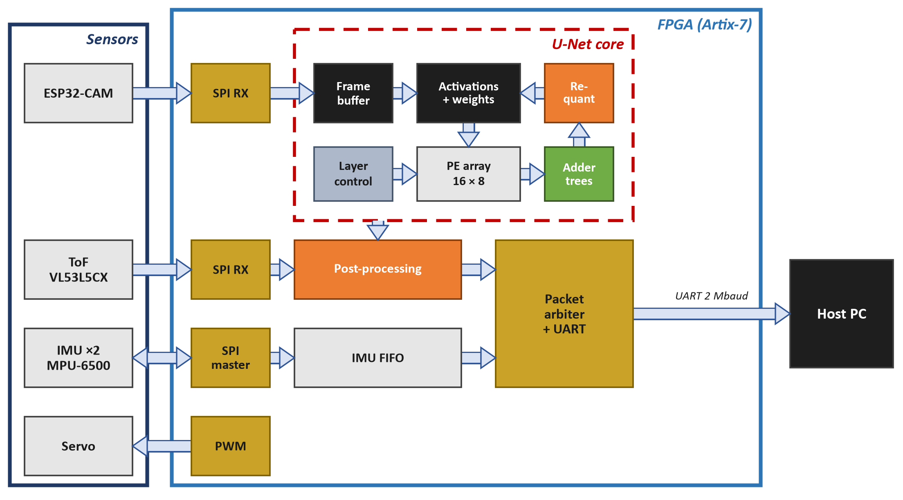
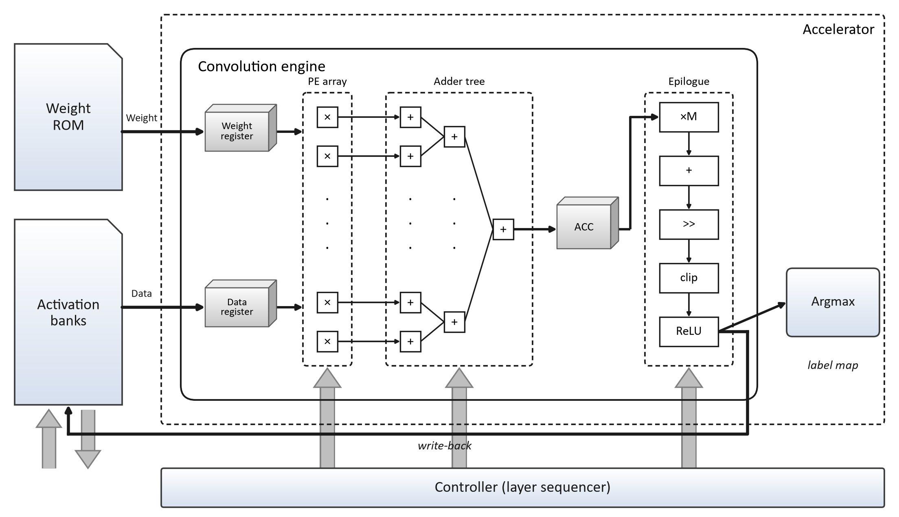
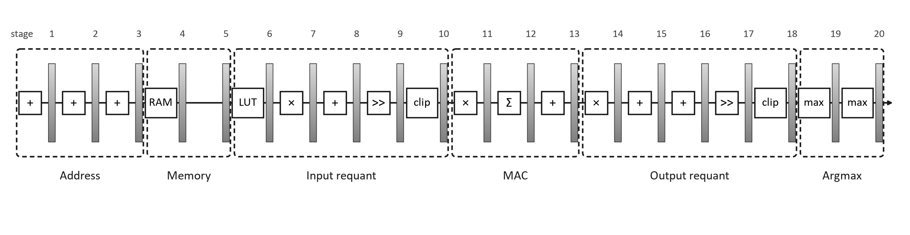
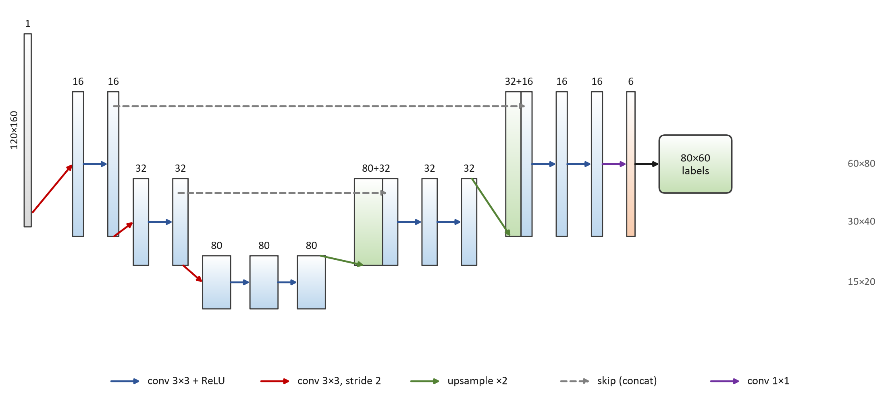
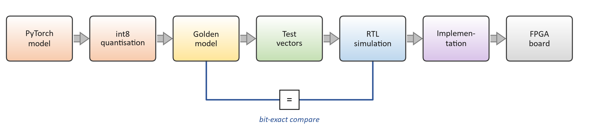

# Figures

Architecture, microarchitecture and datapath figures of the design, at journal size (7.2 in wide, 300 dpi).
`make_figures.py` redraws all of them: `python docs/make_figures.py`.

## Result graphs

`make_plots.py` draws every result graph from stored data in one style (`python docs/make_plots.py`, from the
repository root). Nothing is measured or simulated; it reads the training log, the accuracy and end-to-end
results of the golden model, and the Vivado reports.

| Output folder | Graphs |
|---|---|
| [`model/results/`](../model/results) | `training_curve`, `class_iou_training`, `iou_per_class`, `pixel_agreement`, `confusion_matrix` |
| [`golden_model/results/end_to_end/`](../golden_model/results/end_to_end) | `distance_error` |
| [`hw/results/`](../hw/results) | `resource_utilization`, `resource_by_module`, `timing_slack`, `frame_latency` |

## Fig. 1 - System architecture

The ESP32-CAM and the ToF node are SPI masters that push one packet per frame into the FPGA (8 MHz and 4 MHz).
The FPGA is the SPI master of the two IMUs (0.5 MHz, one shared bus with two chip selects) and generates the
servo PWM. The camera frame is double-buffered, run through the U-Net accelerator, and the resulting 80×60 label
map is combined with the latest ToF frame in the post-processing block. IMU samples are queued in a FIFO. The
packet arbiter sends result packets and IMU packets over one 2 Mbaud UART, never mixing the two.

## Fig. 2 - U-Net accelerator microarchitecture

One convolution layer is computed per pass; a layer descriptor table sequences the 12 layers. The address
generator reads 8 input channels from the 16 activation banks per cycle (layer 0 reads the camera frame through
the input LUT). A requantiser rescales concatenated inputs, and the 16 × 8 PE array multiplies them with 128 int8
weights from the weight ROM. Per output channel an adder tree and an int32 accumulator follow. The epilogue
applies the per-channel multiplier M, rounding, shift, clipping to ±127 and ReLU, then writes 16 channels back
to the banks. The head layer instead feeds an argmax that writes the 80×60 label map.

## Fig. 3 - Convolution datapath

The engine is a 20-stage pipeline with one (input-channel group, kernel tap) per clock cycle. Every stage holds
at most one adder, small multiplier or mux level between registers, which is what closes timing at 100 MHz.

| Stages | Function |
|---|---|
| 1–3 | coordinates, padding, address partial products and sum |
| 4–5 | activation / frame BRAM read with output register |
| 6–10 | lane select, input LUT, concat requantisation (×M, round, shift, clip) |
| 11–13 | 128 int8 products, 4-input partial sums, int32 accumulation |
| 14–18 | output requantisation in DSP slices, clip, ReLU, bank write |
| 19–20 | argmax 16 → 4 → 1 (head layer only) |

## Fig. 4 - Tiny U-Net

Bar height is the spatial resolution, bar width the number of channels (printed above each bar). Input is the
160×120 grey camera frame (shown as 120×160, height × width); output is a 6-class label map of 80×60.
12 convolution layers, 206 K parameters, 164 M multiply-accumulates per frame.

## Fig. 5 - Verification flow

The golden model and the RTL are fed the same test vectors and their outputs are compared byte by byte.
Details in [`golden_model/`](../golden_model).
