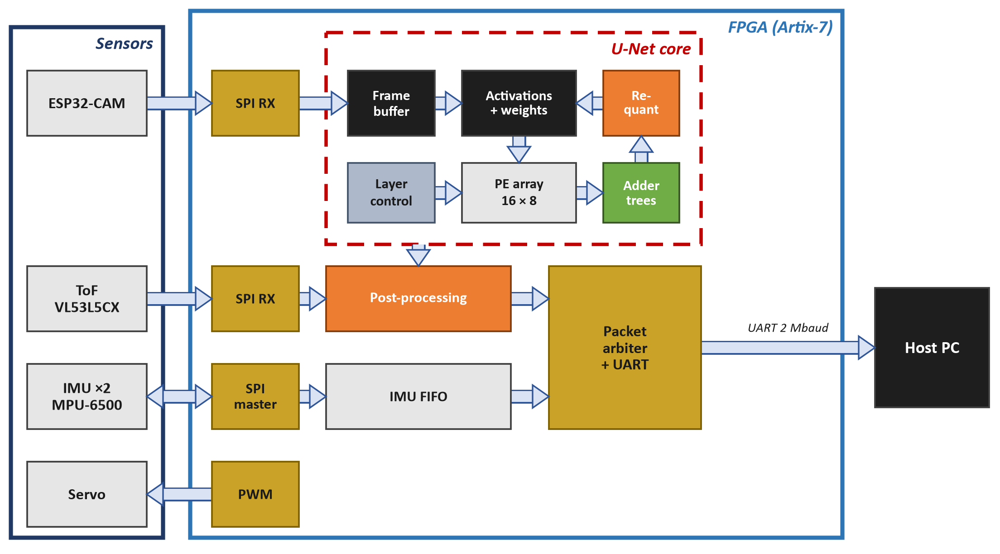
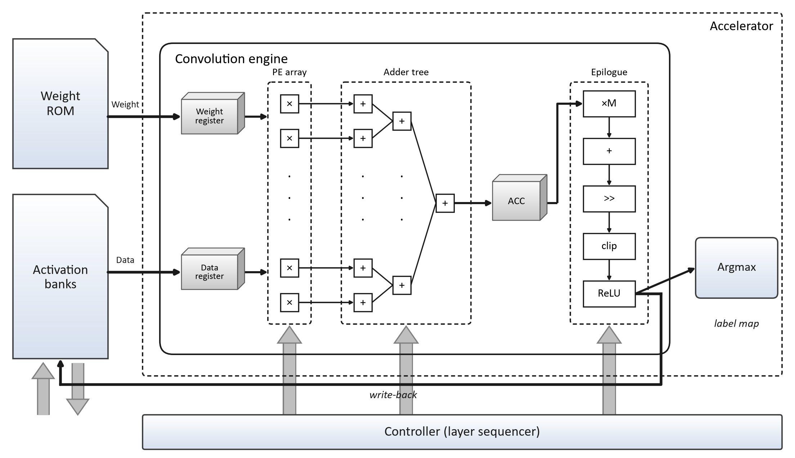
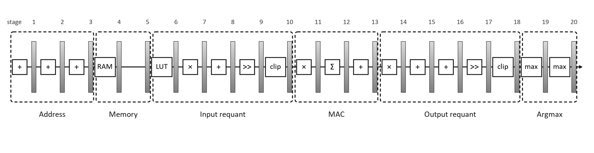
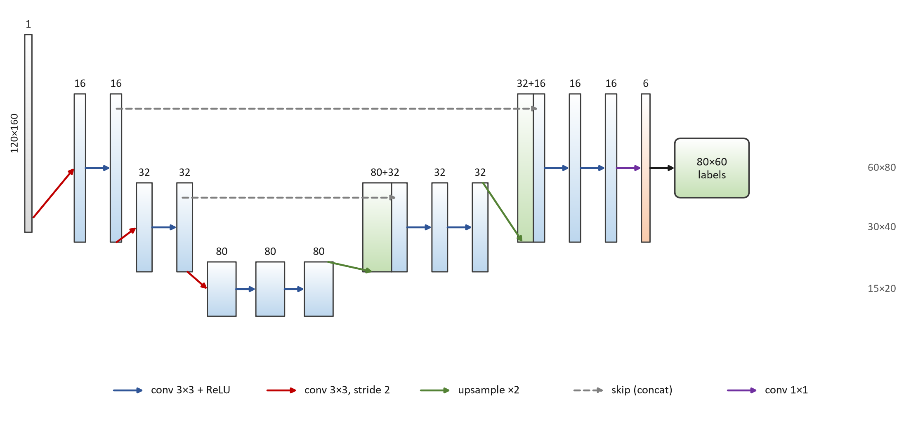
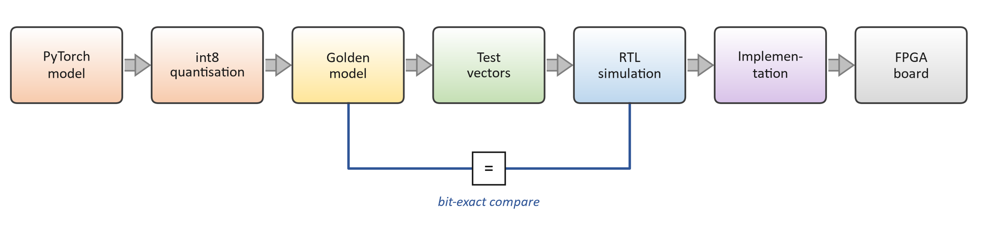

# Figures

Architecture figures drawn by [`../make_figures.py`](../make_figures.py) (300 dpi, 7.2 in wide).
Descriptions: [`../README.md`](../README.md).

| File | Figure |
|---|---|
| `fig1_system_architecture.png` | Sensors, FPGA blocks and host link |
| `fig2_accelerator_microarchitecture.png` | U-Net accelerator: controller, banks, PE array, adder tree, epilogue |
| `fig3_convolution_datapath.png` | 20-stage convolution pipeline |
| `fig4_tiny_unet.png` | Tiny U-Net layer structure |
| `fig5_verification_flow.png` | Golden model and RTL verification flow |

