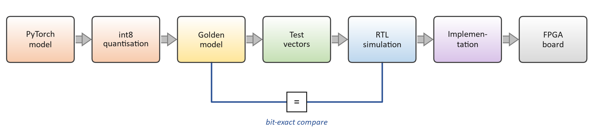
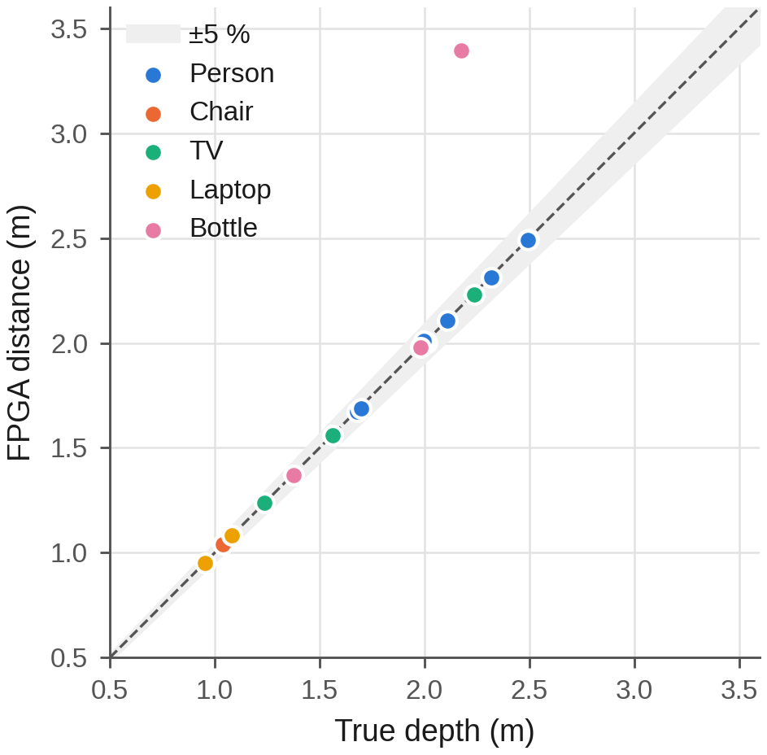
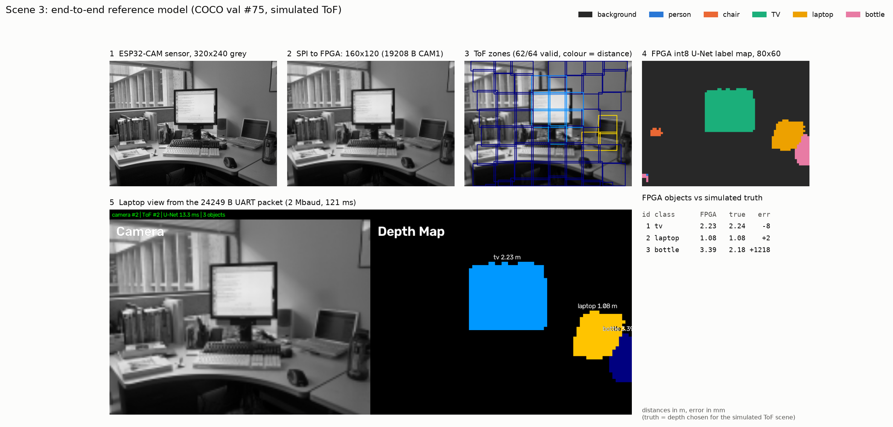

# Golden Model

A Python model of the complete system, one module per hardware stage, from data acquisition on the two ESP32
nodes, through the SPI links and every block of the FPGA, to the UART stream and the host display. The FPGA
stages use exactly the integer arithmetic of the RTL, so the model produces **the same bytes** as the hardware.
It generates the test vectors for the testbenches, and the RTL simulation output is checked against it.



## Stages

| # | Stage | Module | Hardware |
|---|---|---|---|
| 1 | Camera node: 320×240 grey → 2×2 average → 160×120 → `CAM1` packet | `esp32cam_node.py` | ESP32-CAM |
| 2 | ToF node: 8×8 distances + status → `TOF1` packet; ToF scene simulator | `tof_node.py` | ESP32 + VL53L5CX |
| 3 | SPI links and packet receivers (magic, length, checksum) | `spi_link.py` | `spi_rx.sv` |
| 4 | int8 U-Net accelerator, cycle count | `fpga_unet_accelerator.py` | `unet_core.sv`, `unet_engine.sv` |
| 5 | ToF zone projection, connected components, distance per object | `fpga_postprocessing.py` | `postproc.sv` |
| 6 | Result packet: build, parse, transfer time | `uart_link.py` | `uart_tx.sv` |
| 7 | Host side: stream search, depth-map rendering | `laptop_host.py` | `sw/` |

`pipeline.py` chains all stages for one frame. `fpga_model.py` is the bit-exact core shared with `hw/tools/`.
`float_reference.py` runs the float32 network for comparison, and `system_timing.py` computes the latency budget.

## Run

```powershell
pip install -r golden_model/requirements.txt
cd golden_model
python verification/verify_int8_vs_golden_vectors.py     # 12 layers vs golden tensors
python verification/verify_rtl_simulation_output.py      # model vs RTL simulation bytes
python experiments/run_end_to_end_demo.py                # 8 scenes through all stages
python experiments/evaluate_float_vs_int8.py             # 1000 COCO images, about 5 min
```
`run_all.ps1` runs all of them, then redraws the architecture figures (`docs/make_figures.py`) and the
result graphs (`docs/make_plots.py`).

## Results

| Check | Result |
|---|---|
| int8 model vs golden tensors, 12 conv layers + label map | **12/12 bit-exact, 0 label mismatches** |
| Model vs RTL simulation: same SPI input, UART output compared | **0 differing bytes** (2 result packets); corrupted packet rejected by both |
| Damaged packets (bit flip, truncation, wrong magic) | 5/5 rejected |
| float32 vs int8 label maps, 1000 images | 98.17 % identical pixels |
| Object distance vs true depth, 8 scenes, 18 objects (simulated ToF) | median error 4 mm, 17/18 within 5 % |



The one distance outlier is a small bottle at the image edge whose ToF zones mostly see the wall behind it,
a resolution limit of the 8×8 sensor.

### End-to-end example



COCO photos carry no depth, so the ToF frames in this demonstration are simulated from the known object layout
using the real zone geometry of the sensor.

## Contents

| Path | Description |
|---|---|
| `reference_model/` | The model (see Stages) |
| `verification/` | Model vs golden vectors, model vs RTL simulation |
| `experiments/` | End-to-end demonstration, float32 vs int8 evaluation |
| `data/model/` | Trained network (ONNX, int8 package, per-layer `.mem` parameters) |
| `data/golden_vectors/` | Per-layer golden input / output tensors (`$readmemh` format) used by the testbenches |
| `data/rtl_simulation/uart_capture.bin` | UART bytes produced by `tb_nexys4_top` in Vivado xsim |
| `data/tof_geometry/` | Footprint of each ToF zone on the 80×60 grid for 32 distance bins |
| `results/verification/` | Per-layer and per-byte comparison reports |
| `results/accuracy/` | float32 vs int8 metrics, per-image CSV |
| `results/end_to_end/` | Summary, distance graph, and per scene: overview figure, exact SPI and UART bytes, JSON report |
| `run_all.ps1` | Runs every check and experiment, then redraws all figures and graphs |
