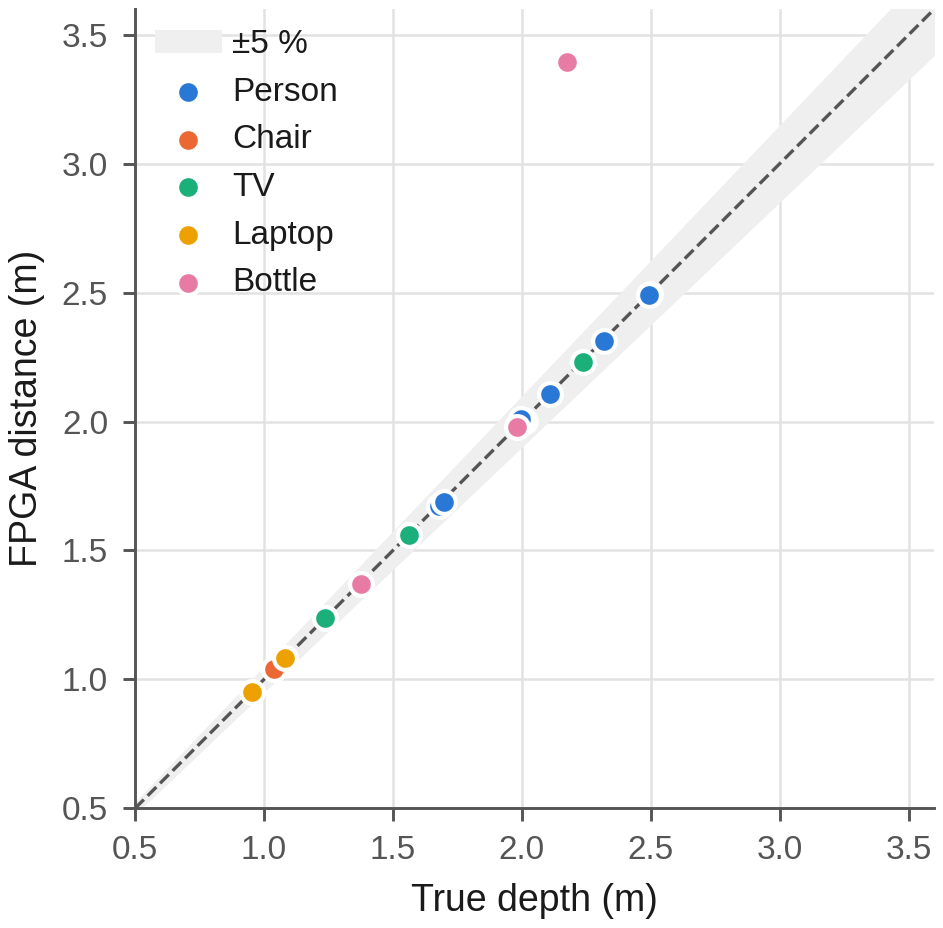

# Golden model results

Written by the scripts in [`../verification`](../verification) and [`../experiments`](../experiments).

| Folder | Content |
|---|---|
| [`verification/`](verification) | int8 model vs golden vectors (12/12 layers bit-exact); model vs RTL simulation (0 differing bytes) |
| [`accuracy/`](accuracy) | float32 vs int8 on 1000 COCO images: 98.17 % pixel agreement, mIoU 0.282 / 0.282 |
| [`end_to_end/`](end_to_end) | 8 scenes through the whole system; object distance median error 4 mm |

