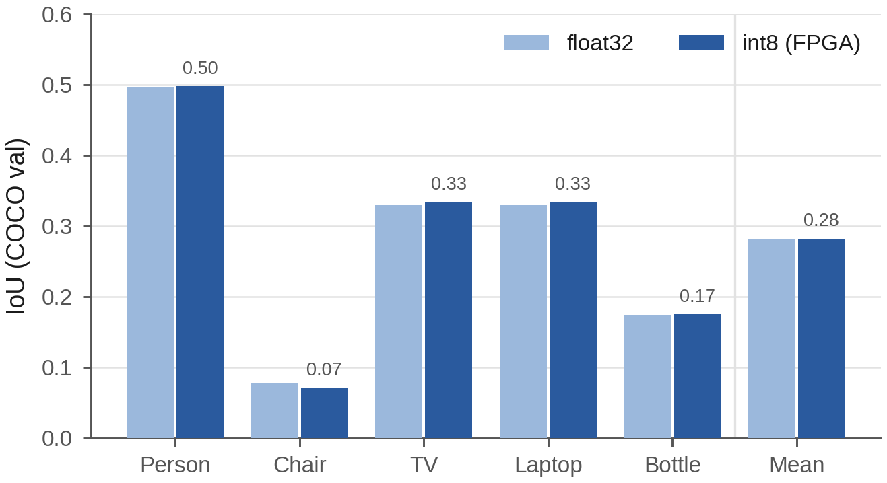
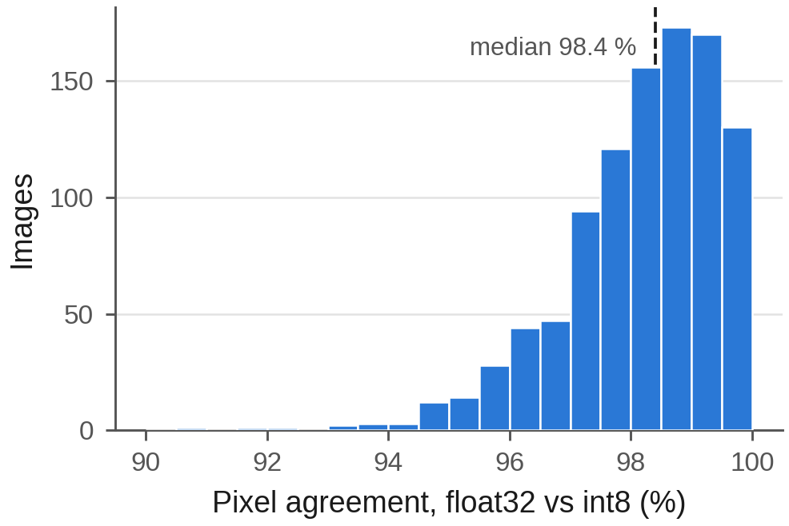

# float32 vs int8 accuracy

Output of `experiments/evaluate_float_vs_int8.py` on 1000 COCO 2017 validation images.

| File | Content |
|---|---|
| `float_vs_int8_metrics.json`, `.txt` | Pixel agreement, pixel accuracy and IoU per class for both networks |
| `per_image_metrics.csv` | Per image: agreement, pixel accuracy float32 / int8, classes present |

| | float32 | int8 (FPGA) |
|---|---|---|
| Pixel accuracy | 82.0 % | 82.3 % |
| Mean IoU (5 object classes) | 0.282 | 0.282 |
| Pixels with the same class | 98.17 % | |

| IoU per class | Pixel agreement per image |
|---|---|
|  |  |
