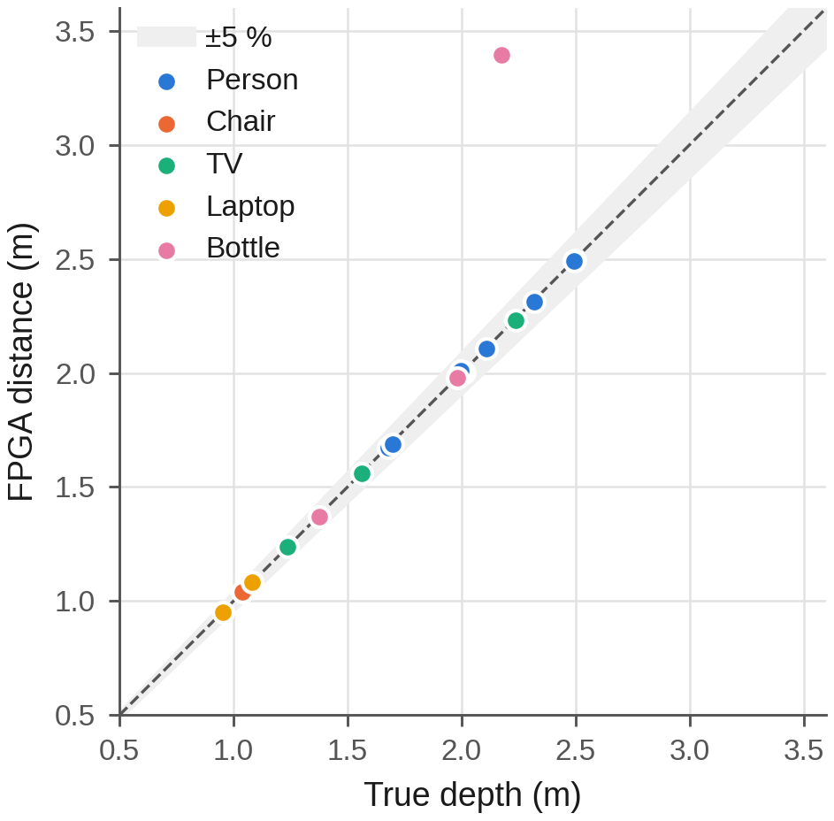

# End-to-end demonstration

Output of `experiments/run_end_to_end_demo.py`: eight COCO validation photos run through every stage of the
system. COCO photos have no depth, so each object is placed at a known depth and the ToF frame is simulated
from that layout with the real zone geometry.

| File | Content |
|---|---|
| `end_to_end_summary.json`, `.txt` | Per scene, per object, damaged-packet checks, time budget |
| `distance_error.png` | FPGA distance vs true depth of every object |
| `scene_XX_<classes>/` | One folder per scene (below) |

| Scene | Objects | float32 / int8 agreement | UART packet (bytes) |
|---|---|---|---|
| [`scene_01_person`](scene_01_person) | Person | 99.9 % | 24225 |
| [`scene_02_chair`](scene_02_chair) | Chair | 99.4 % | 24225 |
| [`scene_03_tv_laptop_bottle`](scene_03_tv_laptop_bottle) | TV, Laptop, Bottle | 99.6 % | 24249 |
| [`scene_04_person_tv`](scene_04_person_tv) | Person, TV | 99.3 % | 24237 |
| [`scene_05_person_bottle`](scene_05_person_bottle) | Person, Bottle | 99.3 % | 24237 |
| [`scene_06_person_tv`](scene_06_person_tv) | Person, TV | 99.1 % | 24261 |
| [`scene_07_person_bottle`](scene_07_person_bottle) | Person, Bottle | 97.0 % | 24249 |
| [`scene_08_person_laptop`](scene_08_person_laptop) | Person, Laptop | 99.5 % | 24237 |

Distance over 18 objects: median error 4 mm, 17 of 18
within 5 %. The outlier is a small bottle at the image edge whose ToF zones mostly see the wall behind it.

