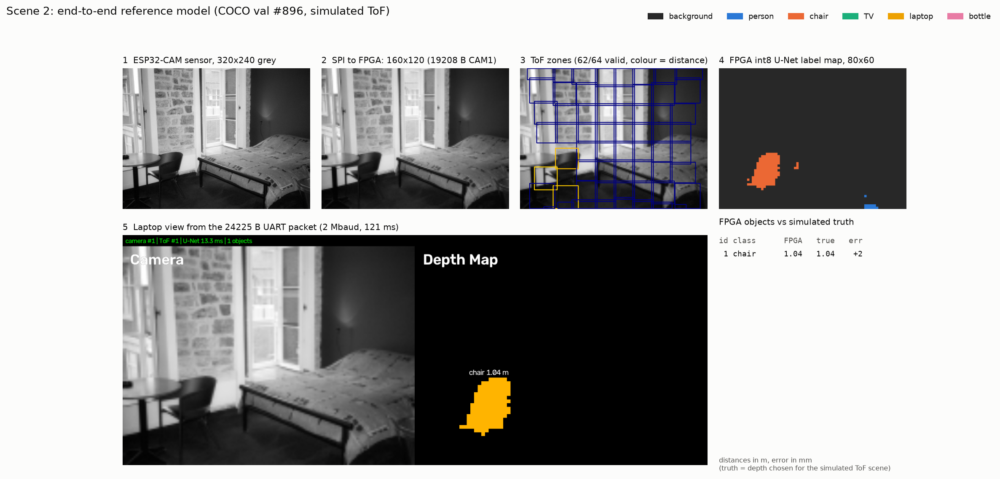

# Scene 2: Chair

COCO 2017 validation image #896 through the whole system (ToF frame simulated,
62/64 valid zones). float32 and int8 label maps agree on
99.4 % of pixels.

| Object | Class | Area (px, 80×60) | ToF zones | FPGA (mm) | True (mm) | Error (mm) |
|---|---|---|---|---|---|---|
| 1 | Chair | 140 | 1 | 1041 | 1039 | +2 |

| File | Content |
|---|---|
| `pipeline_overview.png` | Sensor frame, SPI frame, ToF zones, label map, host view |
| `spi_camera_packet.bin` | Exact `CAM1` packet (19208 bytes) |
| `spi_tof_packet.bin` | Exact `TOF1` packet (200 bytes) |
| `uart_result_packet.bin` | Exact result packet sent to the host (24225 bytes) |
| `scene_report.json` | All values above |
