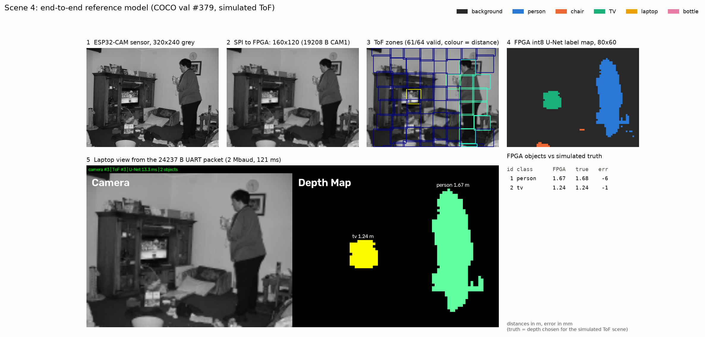

# Scene 4: Person, TV

COCO 2017 validation image #379 through the whole system (ToF frame simulated,
61/64 valid zones). float32 and int8 label maps agree on
99.3 % of pixels.

| Object | Class | Area (px, 80×60) | ToF zones | FPGA (mm) | True (mm) | Error (mm) |
|---|---|---|---|---|---|---|
| 1 | Person | 560 | 9 | 1672 | 1678 | -6 |
| 2 | TV | 107 | 2 | 1237 | 1238 | -1 |

| File | Content |
|---|---|
| `pipeline_overview.png` | Sensor frame, SPI frame, ToF zones, label map, host view |
| `spi_camera_packet.bin` | Exact `CAM1` packet (19208 bytes) |
| `spi_tof_packet.bin` | Exact `TOF1` packet (200 bytes) |
| `uart_result_packet.bin` | Exact result packet sent to the host (24237 bytes) |
| `scene_report.json` | All values above |
