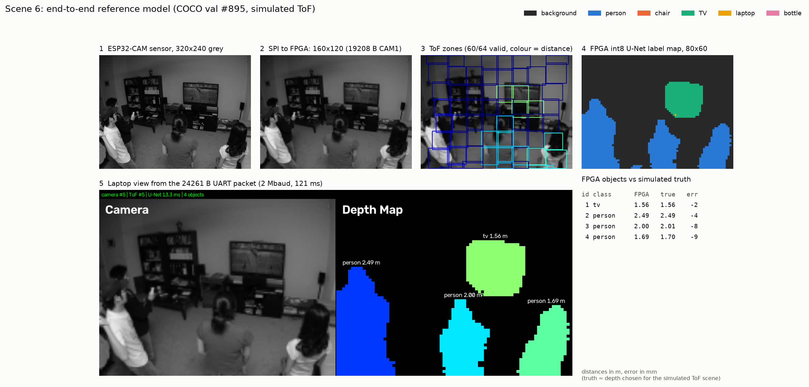

# Scene 6: Person, TV

COCO 2017 validation image #895 through the whole system (ToF frame simulated,
60/64 valid zones). float32 and int8 label maps agree on
99.1 % of pixels.

| Object | Class | Area (px, 80×60) | ToF zones | FPGA (mm) | True (mm) | Error (mm) |
|---|---|---|---|---|---|---|
| 1 | TV | 340 | 5 | 1560 | 1562 | -2 |
| 2 | Person | 567 | 7 | 2490 | 2494 | -4 |
| 3 | Person | 304 | 6 | 2003 | 2011 | -8 |
| 4 | Person | 278 | 4 | 1689 | 1698 | -9 |

| File | Content |
|---|---|
| `pipeline_overview.png` | Sensor frame, SPI frame, ToF zones, label map, host view |
| `spi_camera_packet.bin` | Exact `CAM1` packet (19208 bytes) |
| `spi_tof_packet.bin` | Exact `TOF1` packet (200 bytes) |
| `uart_result_packet.bin` | Exact result packet sent to the host (24261 bytes) |
| `scene_report.json` | All values above |
