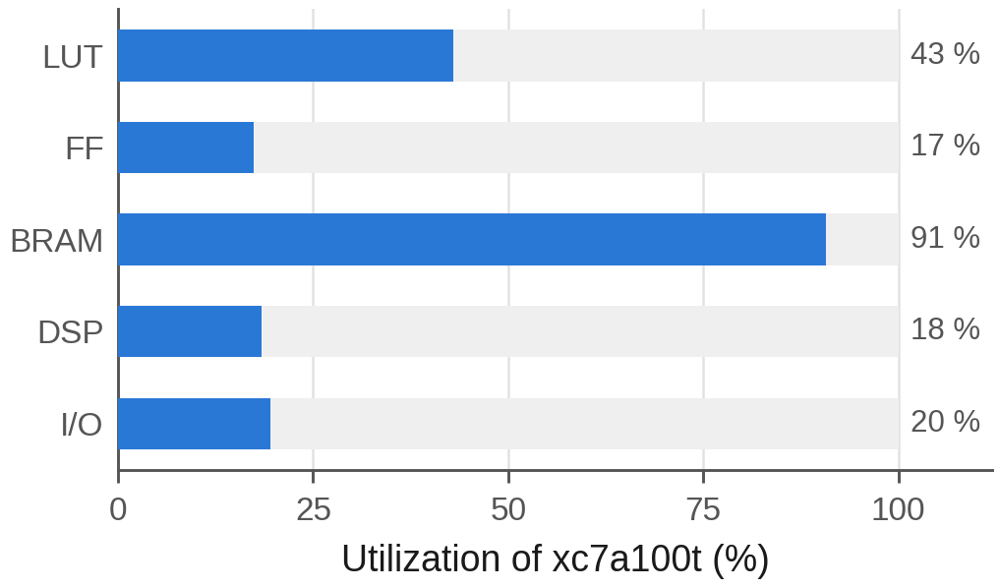
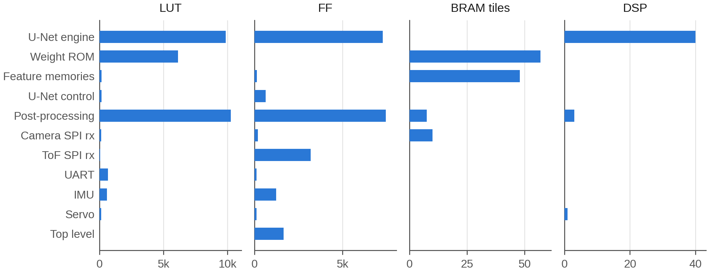
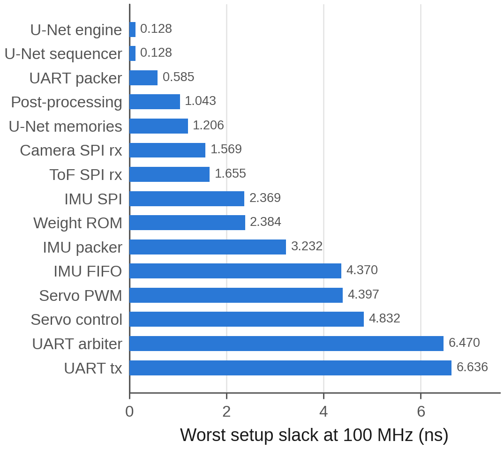
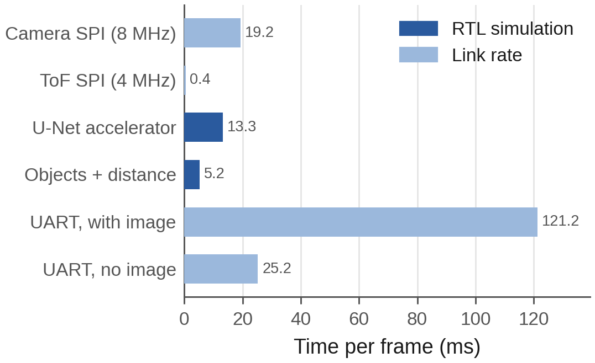
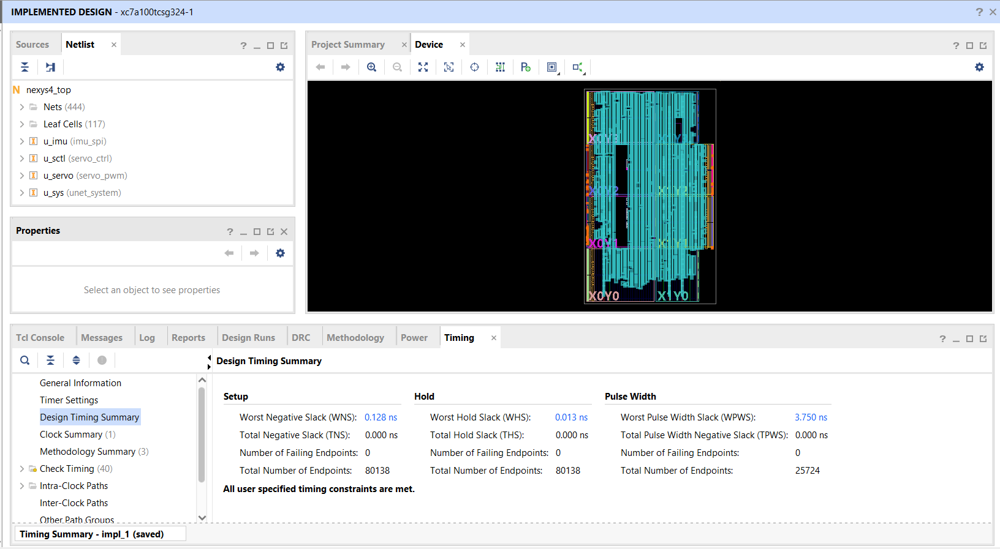

# Hardware

Constraints, scripts, memory images and Vivado results for the Digilent Nexys 4 DDR (XC7A100T-1CSG324C).

## Implementation results (Vivado 2024.1, 100 MHz)

| Resource | Used | Available | Utilisation |
|---|---|---|---|
| Slice LUT | 27 232 | 63 400 | 43.0 % |
| Slice register | 22 036 | 126 800 | 17.4 % |
| Block RAM tile | 122.5 | 135 | 90.7 % |
| DSP48E1 | 44 | 240 | 18.3 % |

| Timing | Value |
|---|---|
| Worst negative slack (setup) | +0.128 ns |
| Worst hold slack | +0.013 ns |
| Failing endpoints | 0 |

| Utilisation | Resources per module |
|---|---|
|  |  |

| Worst setup slack per module | Time per frame |
|---|---|
|  |  |

The graphs are drawn from the reports below by `python docs/make_plots.py`. Vivado views (placement, timing summary, design runs, schematics): [`screenshots/`](screenshots).



Full reports are in [`vivado/reports/`](vivado/reports): `summary.txt`, `utilization*.rpt`, `timing_summary.rpt`,
`timing_per_module.rpt`, `power.rpt`, `io.rpt`, `drc.rpt`, `methodology.rpt` and more.

## Opening the design in Vivado

```powershell
# implemented (placed and routed) design, from the checkpoint - no rebuild
C:\Xilinx\Vivado\2024.1\bin\vivado.bat -nojournal -nolog -source hw\scripts\open_design.tcl -tclargs route
# synthesized design
C:\Xilinx\Vivado\2024.1\bin\vivado.bat -nojournal -nolog -source hw\scripts\open_design.tcl -tclargs synth
# full Vivado project with completed runs and all reports (20-60 min), then open the .xpr
powershell -ExecutionPolicy Bypass -File hw\scripts\build_project.ps1
cd hw\vivado\project; C:\Xilinx\Vivado\2024.1\bin\vivado.bat fpga_perception_system.xpr; cd ..\..\..
```

Useful views: Window → Device (placement), Schematic, Reports → Timing Summary and Report Utilization.

## Build, program, flash

```powershell
powershell -ExecutionPolicy Bypass -File hw\scripts\build.ps1                         # synthesis -> bitstream (20-60 min)
C:\Xilinx\Vivado\2024.1\bin\vivado.bat -nojournal -nolog -mode batch -source hw\scripts\program_board.tcl  # volatile (JTAG)
C:\Xilinx\Vivado\2024.1\bin\vivado.bat -nojournal -nolog -mode batch -source hw\scripts\flash_qspi.tcl     # permanent (QSPI flash)
```
`build.tcl` writes the bitstream only if all timing constraints are met. After `flash_qspi.tcl`, set jumper JP1
to QSPI; the design then loads at power-up.

## Contents

| Path | Description |
|---|---|
| `constraints/nexys4_ddr.xdc` | Pins, clock, I/O standards, false paths for asynchronous inputs |
| `scripts/build.ps1`, `build.tcl` | Non-project build with timing-driven directives and per-module timing report |
| `scripts/build_project.ps1`, `build_project.tcl` | Vivado project build: `vivado/project/fpga_perception_system.xpr` with completed runs, reports in `vivado/reports/` |
| `scripts/create_vivado_project.tcl` | Creates the Vivado project (sources only) in `vivado/project/` |
| `scripts/open_design.tcl` | Opens `post_synth.dcp` or `post_route.dcp` in the GUI |
| `scripts/run_sim.ps1` | xsim runs of all testbenches |
| `scripts/program_board.tcl`, `flash_qspi.tcl` | JTAG programming, QSPI flash programming |
| `scripts/prepare.ps1` | Regenerates every memory image after retraining |
| `mem/` | Weight, parameter, input-LUT and ToF-zone ROM images; testbench vectors (`tb_*.mem`) |
| `tools/` | Python generators: weight packing, ToF zone tables, test vectors; `fpga_model.py` bit-exact model; capture checker |
| `results/` | Resource, timing and latency graphs |
| `screenshots/` | Vivado GUI screenshots |
| `vivado/bitstream/` | Board-tested bitstream `fpga_perception_system.bit` and QSPI flash image `.mcs` / `.prm` |
| `vivado/checkpoints/` | Synthesized and routed design checkpoints `post_synth.dcp`, `post_route.dcp` |
| `vivado/reports/` | Timing, area, power, I/O, DRC and methodology reports |
| `vivado/logs/` | Build logs |
| `vivado/project/` | Vivado project `fpga_perception_system.xpr` with completed runs |

## Board I/O

| Signal | Nexys 4 DDR |
|---|---|
| Camera SPI (CS, MOSI, SCLK) | JA1, JA2, JA4 |
| ToF SPI (CS, MOSI, SCLK) | JB1, JB2, JB4 |
| IMU SPI (CS1, MISO, MOSI, SCLK, CS2) | JC1, JC2, JC3, JC4, JC7 |
| Servo PWM | JD1 |
| UART to host | USB-UART (D4), 2 Mbaud |
| SW0 / SW1 / SW15–SW8 | camera image in packets / servo sweep / servo angle (manual) |
| LED0–LED15 | heartbeat, packet activity, busy flags, packet errors, object count |
