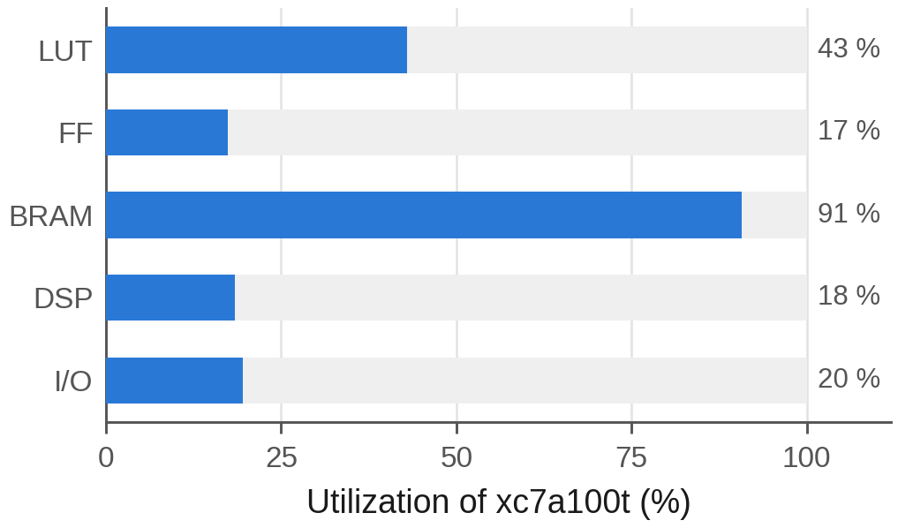
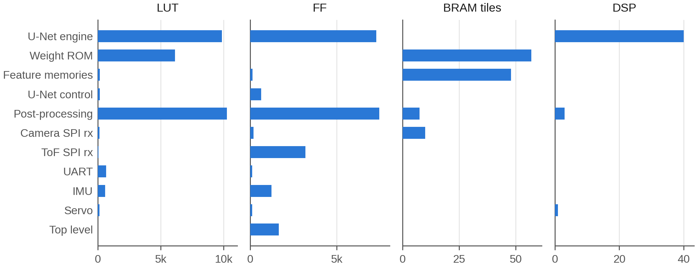
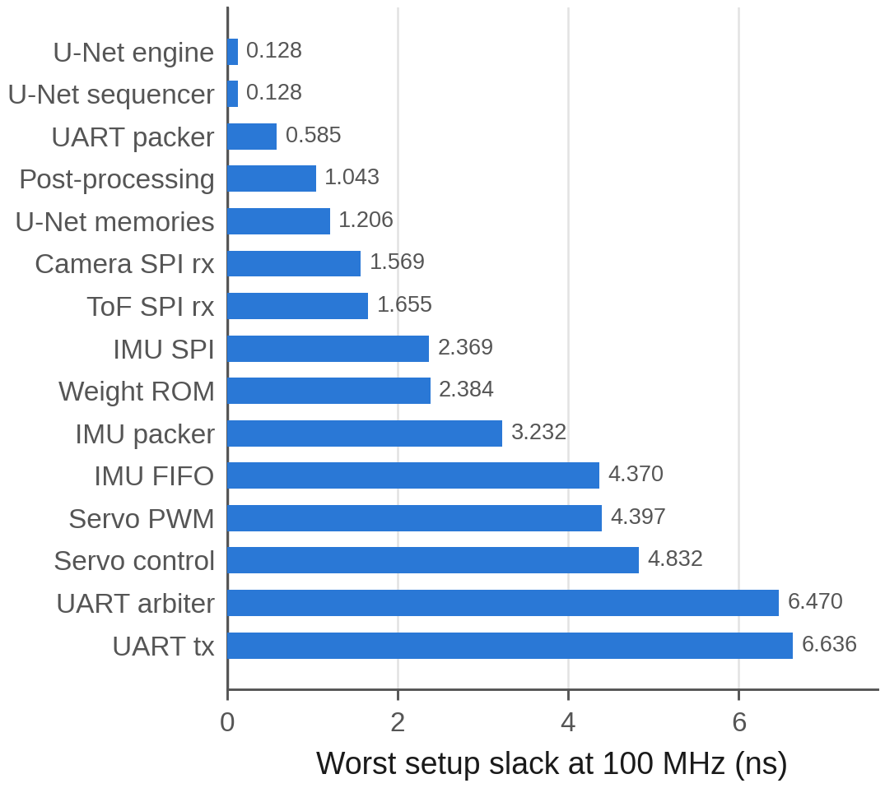
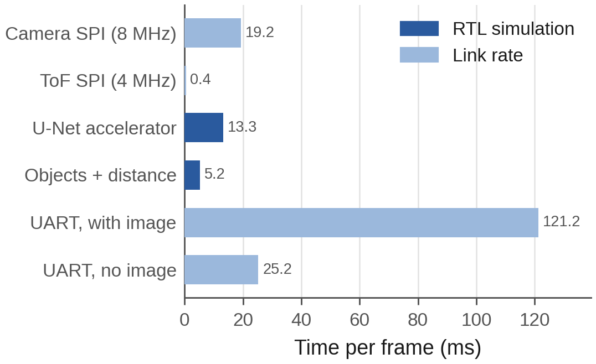

# Implementation results

Drawn from the Vivado reports in [`../vivado`](../vivado) and the time budget of the golden model by
`python docs/make_plots.py`.

| Utilisation of the XC7A100T | Resources per module |
|---|---|
|  |  |

| Worst setup slack per module (100 MHz) | Time per frame |
|---|---|
|  |  |

Block RAM is the limiting resource (122.5 of 135 tiles): the weight ROM and the 16 activation banks hold the
whole network on chip. The critical path (+0.128 ns) is in the U-Net engine. In the time budget, U-Net and
post-processing times come from RTL simulation and link times from the link rates; with the camera image in
each packet, the 2 Mbaud UART limits the frame rate.
