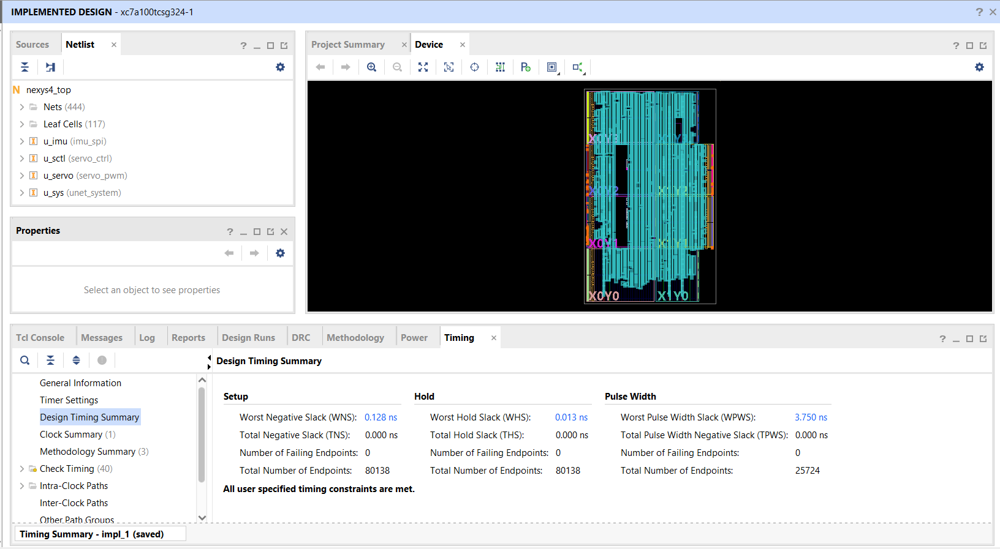
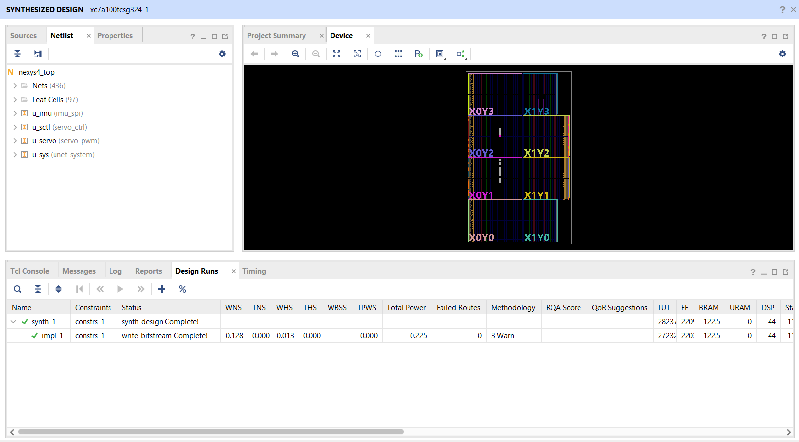
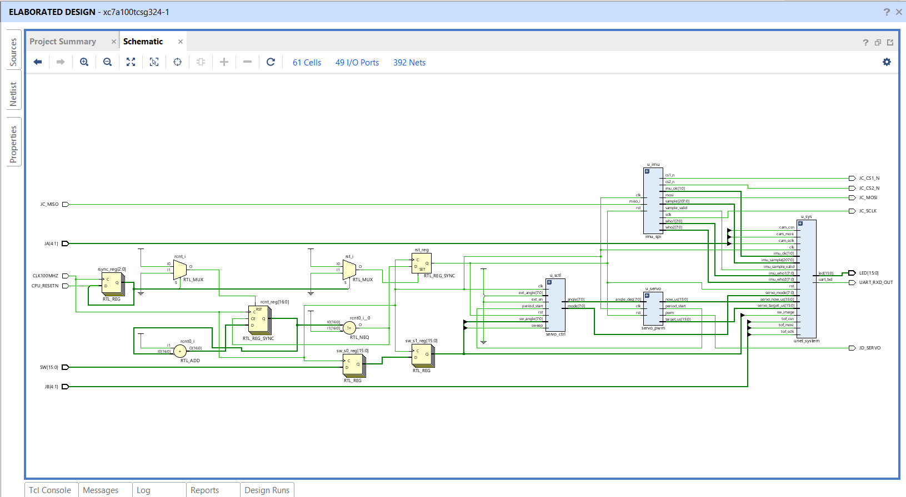
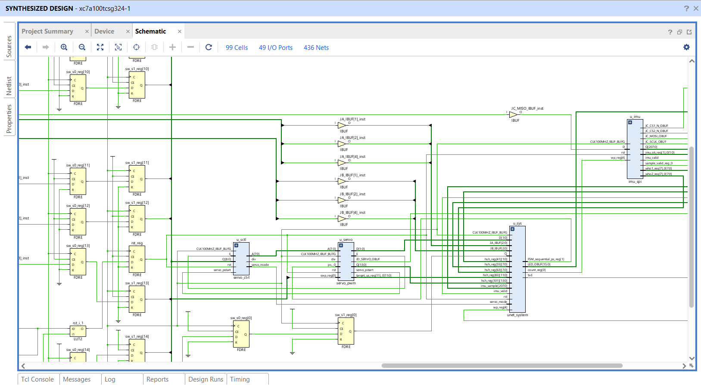

# Vivado screenshots

Vivado 2024.1, project `hw/vivado/project/fpga_perception_system.xpr` (xc7a100tcsg324-1).

**Implemented design: placement and timing summary.** All constraints met: WNS +0.128 ns, WHS +0.013 ns,
WPWS 3.750 ns, 0 failing of 80 138 endpoints.

**Design runs.** Synthesis and implementation complete, bitstream written; 27 232 LUT, 122.5 BRAM tiles,
44 DSP, 0.225 W total on-chip power.

**RTL (elaborated) schematic of the top level.** Synchronisers, `u_imu` (IMU SPI master), `u_sctl` / `u_servo`
(servo control and PWM) and `u_sys` (camera and ToF receivers, U-Net, post-processing, UART).

**Synthesized schematic of the top level.** Input buffers of the Pmod pins, switch registers and the same
four sub-modules after synthesis.

Reports behind these views: [`../vivado/reports/`](../vivado/reports).
