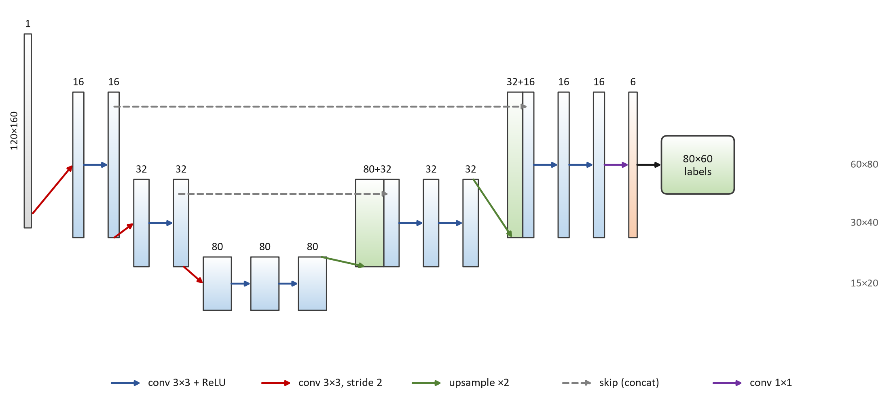
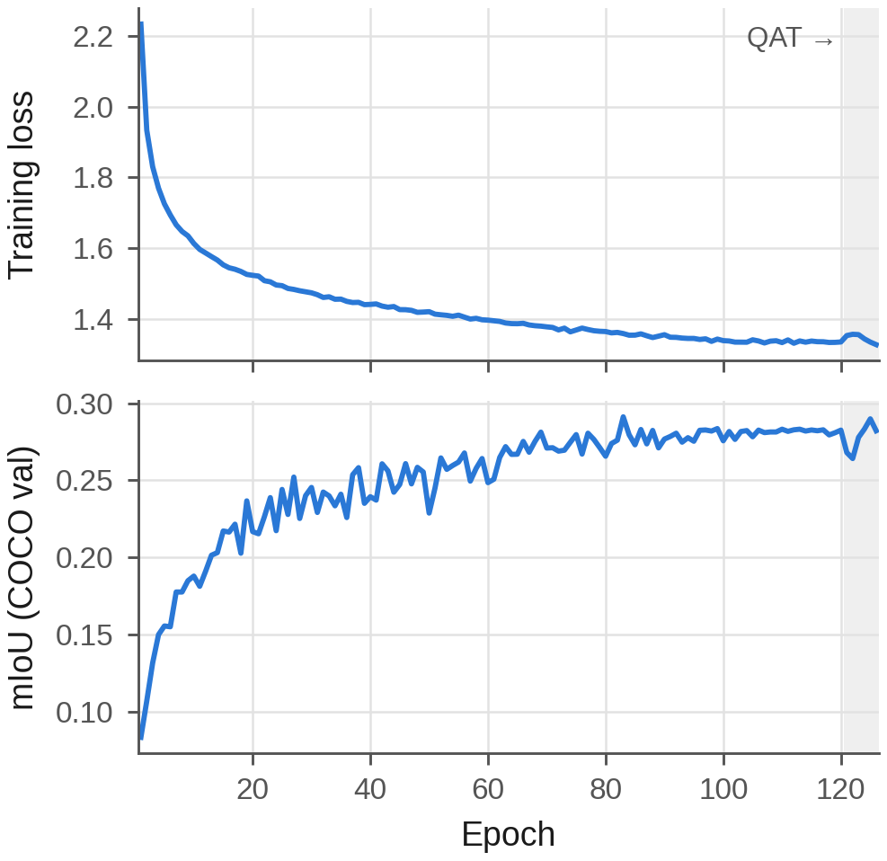
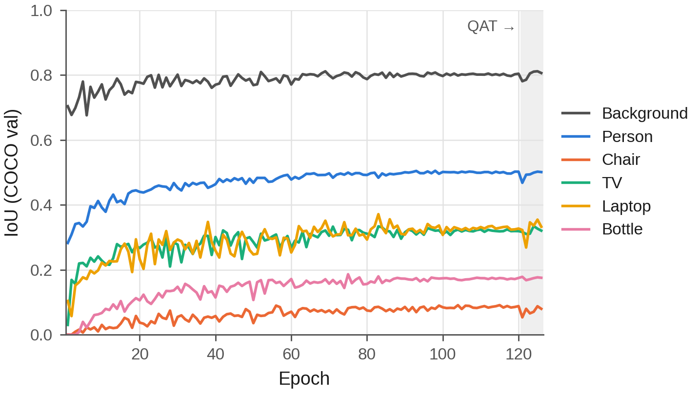
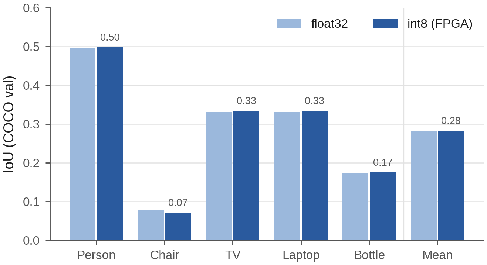
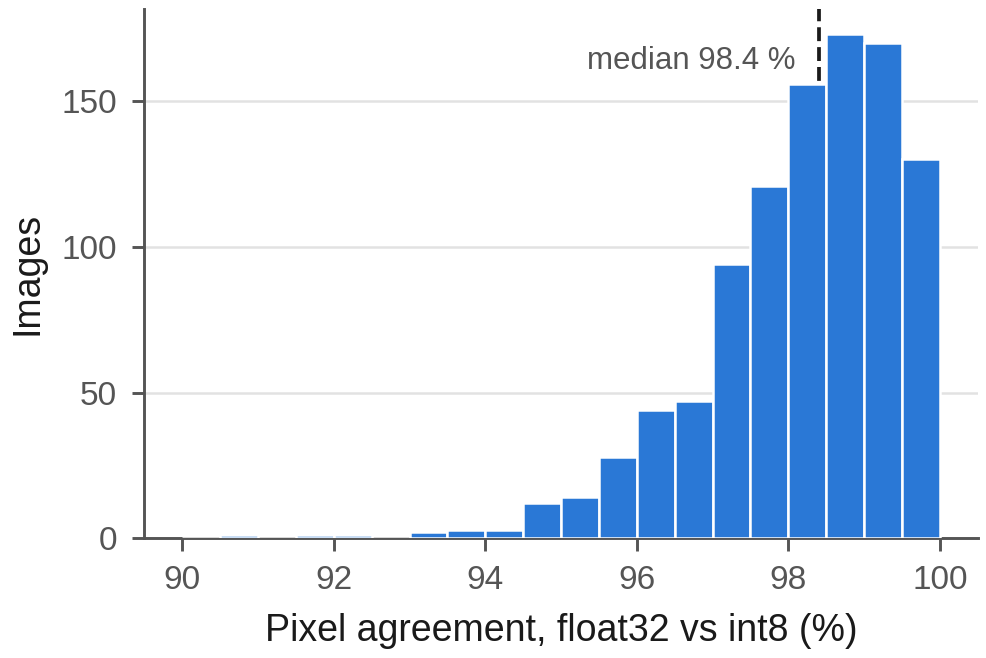
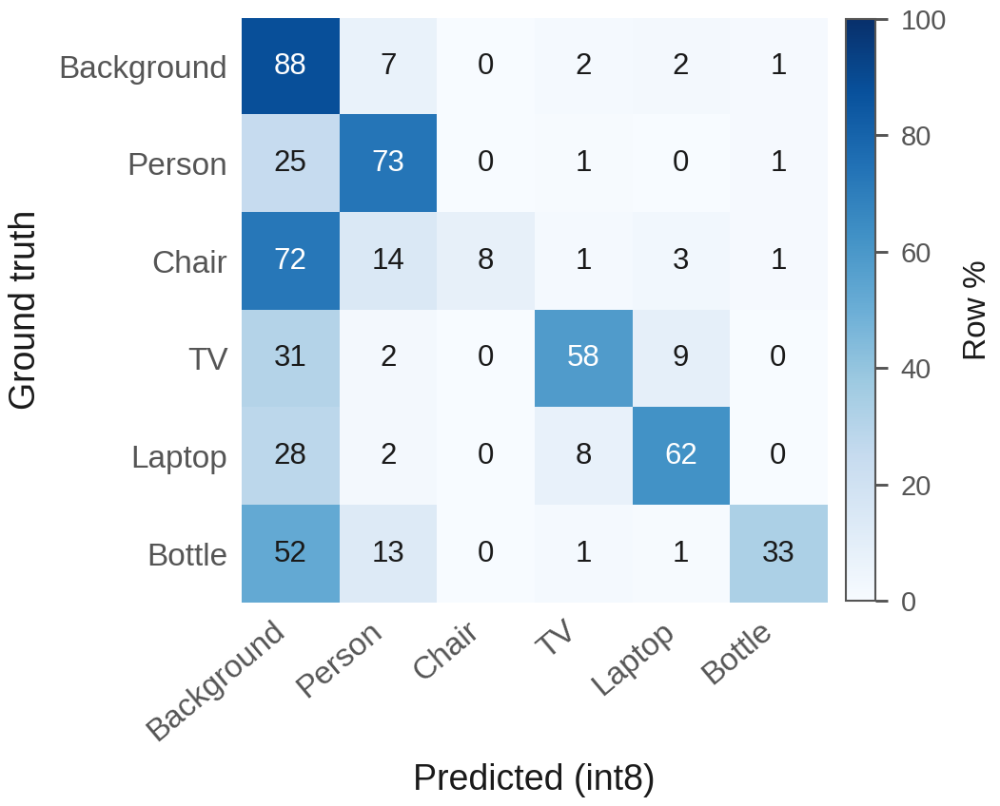
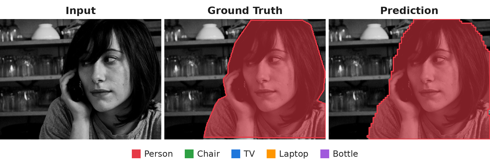
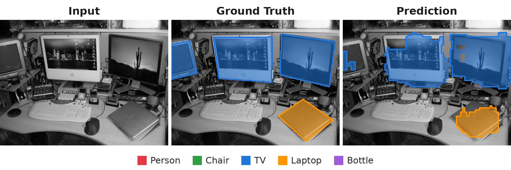
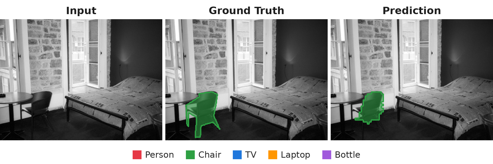
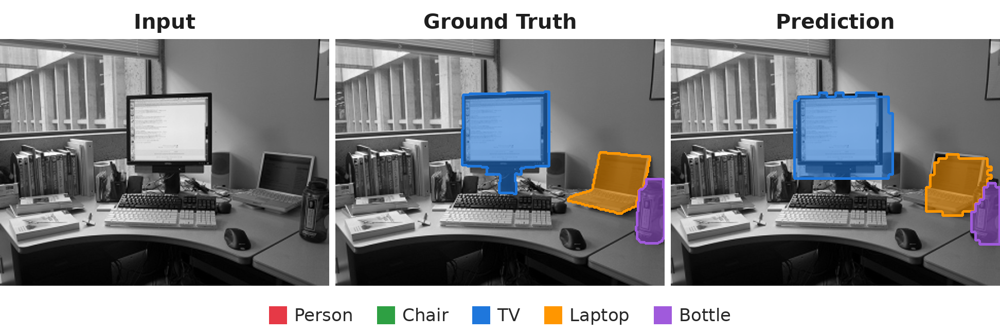

# Model: Tiny U-Net

A compact encoder–decoder segmentation network sized to fit the on-chip memory of the XC7A100T. It labels
every pixel of the camera frame with one of six classes (background, person, chair, tv, laptop, bottle).



| Property | Value |
|---|---|
| Input / output | 160×120 grey / 80×60 label map |
| Layers | 12 convolutions (3×3 and one 1×1 head), ReLU, ×2 upsampling, 2 skip connections |
| Channels | 16, 32, 80 |
| Parameters | 206 K int8 weights; weights and activations use 105 of the 135 FPGA block RAM tiles |
| Work per frame | 164 M MAC |
| Arithmetic | int8 weights per output channel, int8 activations per tensor, int32 accumulation, 15-bit multiplier + shift requantisation |

## Training

PyTorch on an RTX 4050 laptop GPU: 120 float epochs, then 6 epochs of quantisation-aware training (QAT) in
which the network sees the FPGA's int8 rounding. Images are augmented with ESP32-CAM-like distortions
(exposure, blur, noise, JPEG artefacts).

| Loss and mIoU | IoU per class |
|---|---|
|  |  |

```powershell
cd model/training
pip install -r requirements.txt                        # plus PyTorch with CUDA
python prepare_coco.py                                 # COCO subset -> dataset/prepared
python train.py --epochs 120                           # float training, then 6 QAT epochs
python export_onnx.py                                  # ONNX -> model/quantization/models
python evaluate.py                                     # IoU per class
python quantize_fpga.py                                # int8 package, golden vectors, bit-exact check
```
`run_all.bat` runs every step in order.

## Results

1000 COCO 2017 validation images, never used in training:

| | float32 | int8 (FPGA arithmetic) |
|---|---|---|
| Pixel accuracy | 82.0 % | 82.3 % |
| IoU person / chair / tv / laptop / bottle | 0.497 / 0.078 / 0.331 / 0.330 / 0.173 | 0.498 / 0.071 / 0.334 / 0.334 / 0.175 |
| Mean IoU (5 object classes) | 0.282 | 0.282 |
| Same class in both label maps | 98.17 % of pixels | |

| IoU, float32 vs int8 | Pixel agreement per image |
|---|---|
|  |  |

Most errors are object pixels labelled as background (confusion matrix, rows = ground truth):



## Predictions

Input, ground truth and int8 prediction on COCO validation images, covering all five classes. All ten are in
[`predictions/`](predictions).

| | |
|---|---|
|  |  |
|  |  |

## Contents

| Path | Description |
|---|---|
| `training/` | Training scripts: data preparation, model definition, training, QAT, export, quantisation, evaluation |
| `quantization/fpga_ref/` | int8 toolkit: graph export, calibration, integer reference engine, `.mem` writer, [`INT8_SPEC.md`](quantization/fpga_ref/INT8_SPEC.md) |
| `quantization/models/` | Exported ONNX model and the int8 FPGA package |
| `weights/unet_float32.pt` | Best float checkpoint |
| `weights/unet_int8_qat.pt` | Best QAT checkpoint (the deployed network) |
| `weights/unet_float32.onnx` | ONNX export |
| `weights/unet_int8.npz` | int8 weights, biases and scales used by the FPGA |
| `results/` | Training log, float32 vs int8 metrics, confusion matrix and graphs (drawn by `docs/make_plots.py`) |
| `predictions/` | Ten prediction images (input, ground truth, int8 output) |

The prediction images are COCO 2017 photos; each keeps its Flickr licence (several are non-commercial).
