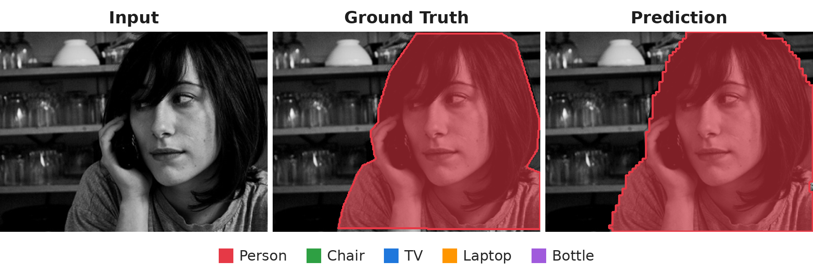
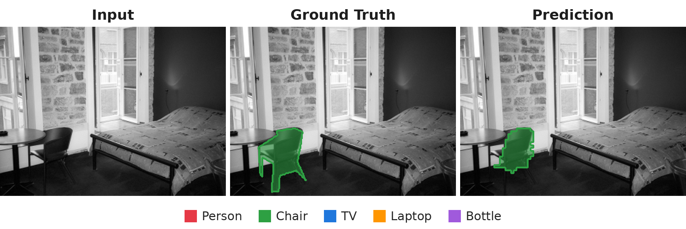
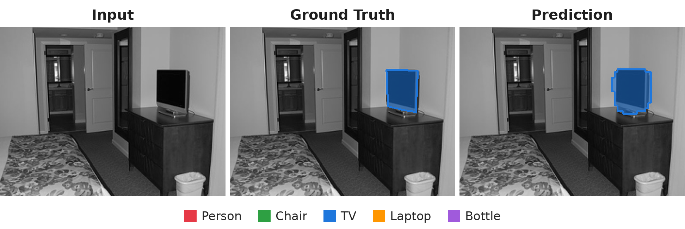
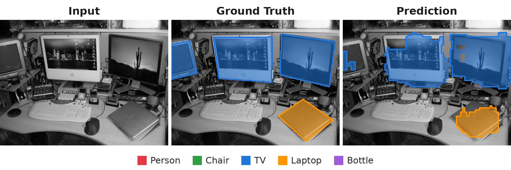
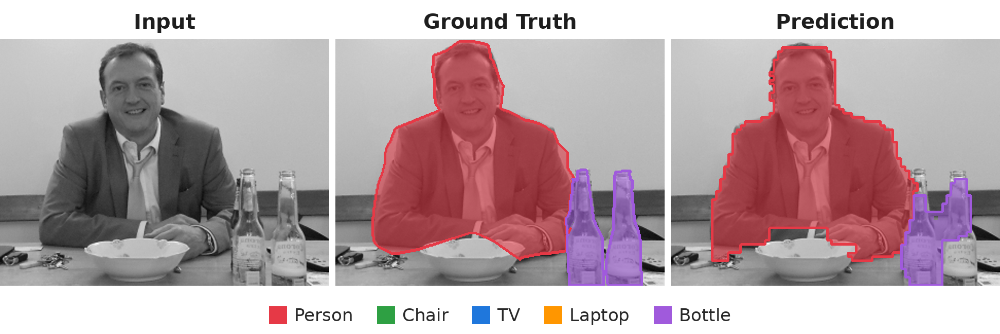
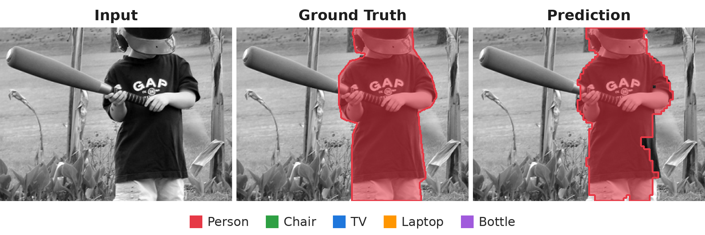
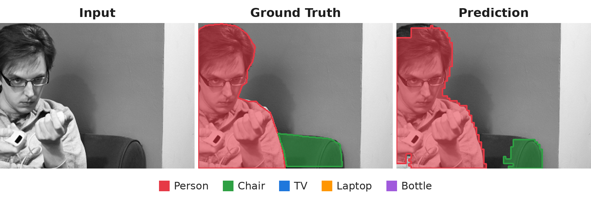
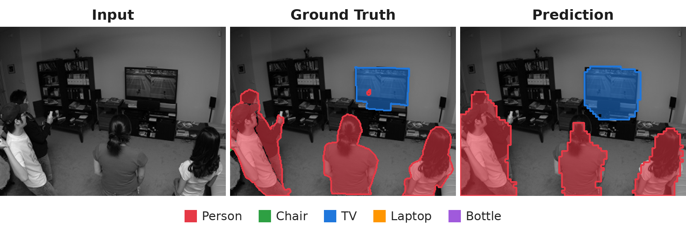
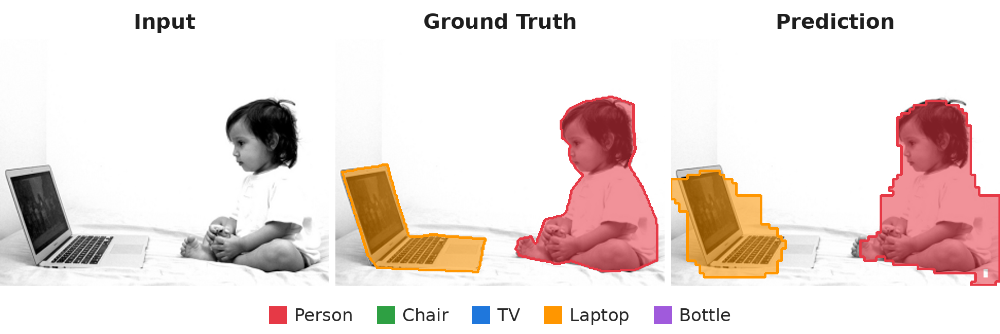
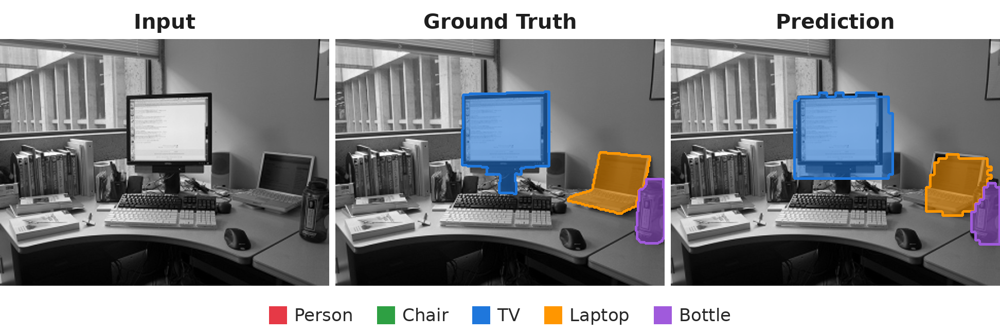

# Predictions

Input, COCO ground truth and int8 network output on validation images not used in training.
Each image keeps its Flickr licence (COCO 2017).

**Person** (`person_1.png`)

**Chair** (`chair.png`)

**TV** (`tv.png`)

**TV and laptop** (`tv_laptop.png`)

**Person and bottle** (`person_bottle.png`)

**Person** (`person_2.png`)

**Person and chair** (`person_chair.png`)

**Person and TV** (`person_tv.png`)

**Person and laptop** (`person_laptop.png`)

**TV, laptop and bottle** (`tv_laptop_bottle.png`)

