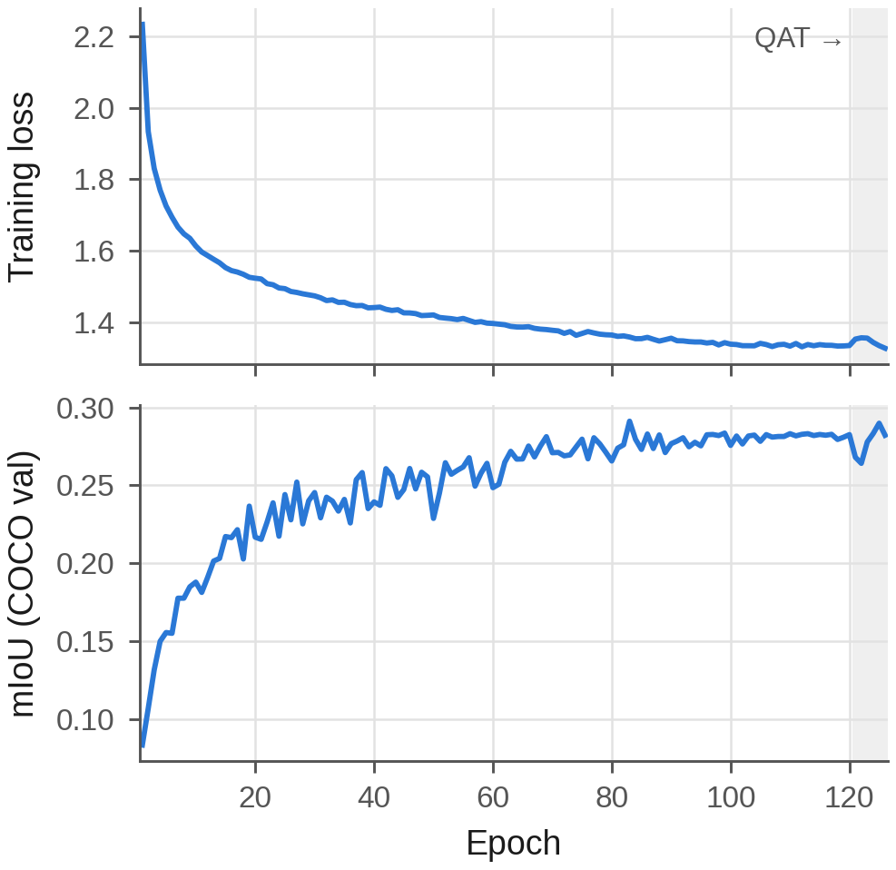
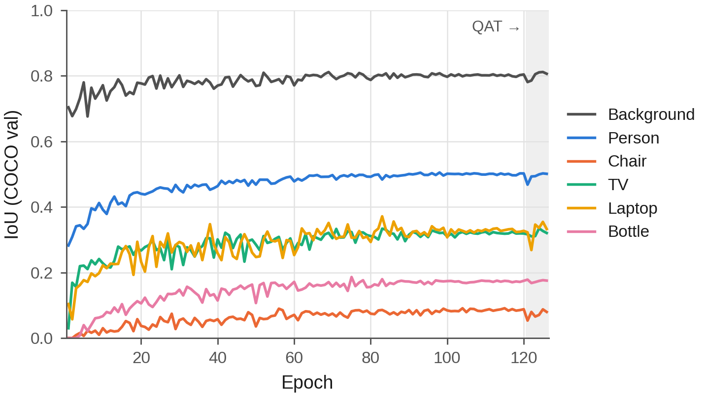
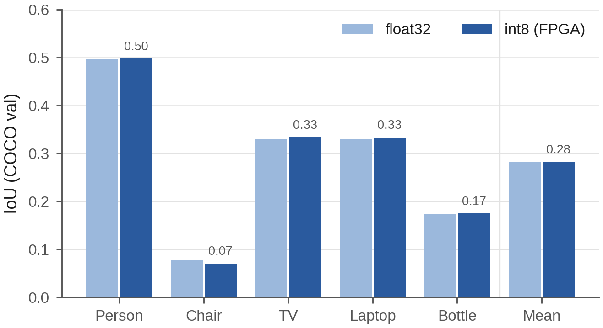
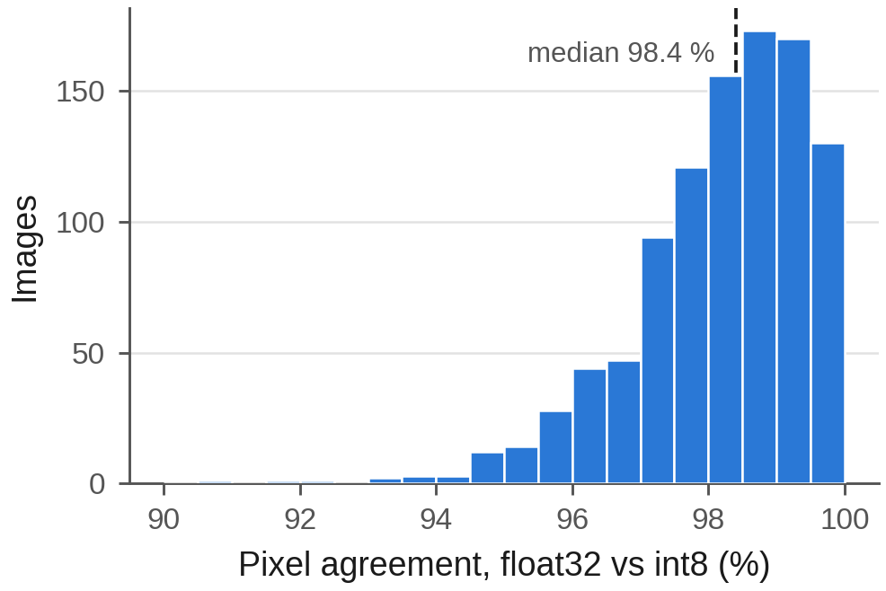
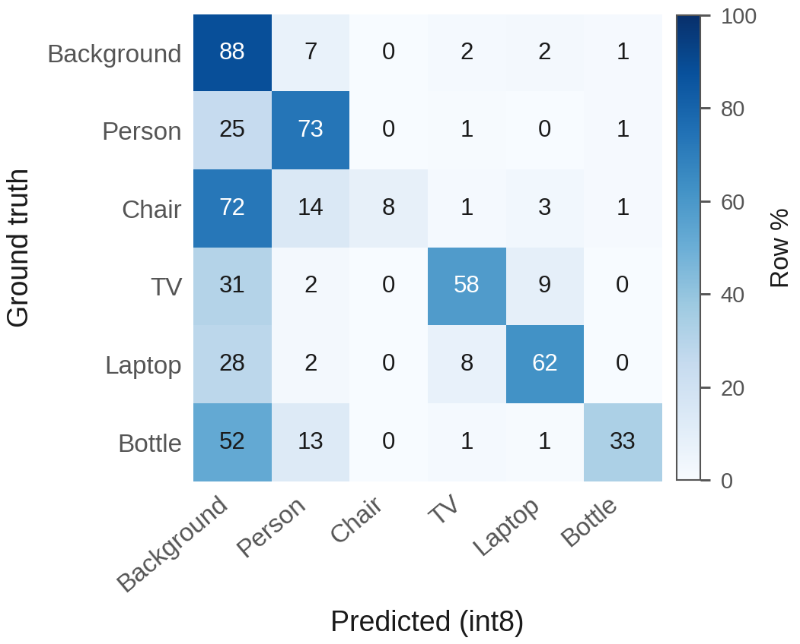

# Model results

Graphs drawn from the files below by `python docs/make_plots.py`.

| File | Content |
|---|---|
| `training_log.csv` | Per epoch: phase (float / QAT), loss, time, IoU per class on COCO val |
| `float32_vs_int8_metrics.txt` | float32 vs int8 on 1000 COCO validation images |
| `confusion_matrix.csv` | int8 confusion matrix in pixels (rows = ground truth) |

| Training loss and mIoU | IoU per class during training |
|---|---|
|  |  |

| IoU, float32 vs int8 | Pixel agreement per image |
|---|---|
|  |  |

120 float epochs, then 6 quantisation-aware epochs (shaded). The int8 network matches the float32 network
(mean IoU 0.282 for both, 98.17 % of pixels identical). Most errors are object pixels labelled as background,
mainly for the small or rare classes chair and bottle.
