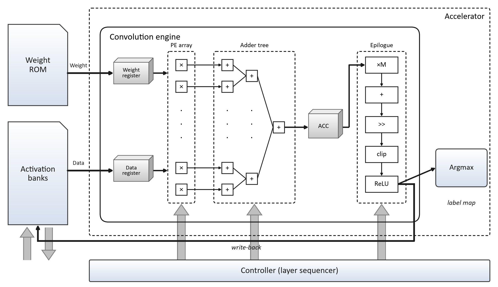

# RTL

SystemVerilog (IEEE 1800-2012) design for the Nexys 4 DDR, single 100 MHz clock domain.

## Modules

| File | Module(s) | Function |
|---|---|---|
| `nexys4_top.sv` | `nexys4_top` | Board top level: pins, reset synchroniser, switch synchronisers |
| `unet_system.sv` | `unet_system` | Receivers, accelerator, post-processing, packers and the frame control FSM |
| `spi_rx.sv` | `cam_rx`, `tof_rx` | SPI slaves with packet checks; double frame buffer; ToF registers |
| `unet_core.sv` | `unet_core` | Layer sequencer, activation banks, weight / parameter ROMs |
| `unet_engine.sv` | `unet_engine` | 128-MAC convolution engine, 20-stage pipeline, requantisation, argmax |
| `unet_layers_pkg.sv` | `unet_layers_pkg` | Layer descriptor table (generated by `hw/tools/unet_pack.py`) |
| `unet_pkg.sv` | `unet_pkg` | Shared constants and types |
| `postproc.sv` | `postproc` | ToF zone painting, connected components, object statistics, distance |
| `uart_tx.sv` | `uart_tx`, `uart_packer` | UART transmitter and result-packet builder |
| `imu_spi.sv` | `imu_spi` | SPI master for two MPU-6500: initialisation, WHO_AM_I, 100 Hz burst reads |
| `imu_packer.sv` | `imu_fifo`, `imu_packer`, `uart_arbiter` | IMU sample FIFO (LUT-RAM), IMU packet builder, packet arbiter |
| `servo_pwm.sv` | `servo_pwm`, `servo_ctrl` | 50 Hz PWM with angle limits and slew limit; manual / sweep modes |
| `bram.sv` | `ram_sdp`, `ram_sdp_ch`, `ram_sdp_lut`, `rom_sp`, `rom_lut` | Inferred block-RAM, LUT-RAM and ROM wrappers |
| `conv_engine.sv` | `conv_engine` | Single-lane reference engine (stage-1 verification only, not in the build) |

## Interfaces

| Port | Pins | Protocol |
|---|---|---|
| Camera | Pmod JA | SPI slave, mode 0, `CAM1` packet: magic, frame no, 19 200 pixels, sum16 |
| ToF | Pmod JB | SPI slave, mode 0, `TOF1` packet: magic, frame no, 64 × u16 mm, 64 × u8 status, sum16 |
| IMUs | Pmod JC | SPI master, mode 0, 0.5 MHz, two chip selects |
| Servo | Pmod JD1 | PWM, 20 ms period, 1000–2000 µs |
| Host | USB-UART (D4) | 2 Mbaud 8N1: result packets `A5 5A 46 50`, IMU packets `A5 5A 49 4D`, each with sum16 |

## Memory map of the accelerator

| Memory | Size | Implementation |
|---|---|---|
| Activation banks | 16 × 12 000 × 8 bit | 48 RAMB36 |
| Weight ROM | 2048 × 1024 bit (1613 used) | about 58 RAMB36 |
| Parameter ROM | 32 × 896 bit | LUT ROM |
| Frame buffer | 2 × 19 200 × 8 bit | block RAM |

Simulation: [`tb/`](../tb). Build: [`hw/`](../hw).
